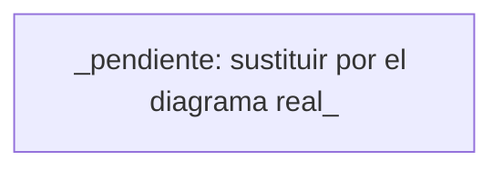

# Con qué se construye

**Cuándo se consulta:** antes de añadir una dependencia, una integración, una carpeta nueva o
un servidor MCP; y en cada sesión para arrancar la app. **Cuándo se actualiza:** cuando cambia el
stack, la estructura o se toma una decisión técnica. El cambio se registra en `changelog/`.

## Stack

<!-- Una fila por capa. "Por qué" en una frase: qué alternativa se descartó y a cambio de qué. -->

| Capa | Tecnología | Por qué |
|------|-----------|---------|
| Aplicación | _(pendiente)_ | _(pendiente)_ |
| Datos | _(pendiente)_ | _(pendiente)_ |
| Autenticación | _(pendiente)_ | _(pendiente)_ |
| Estilos | _(pendiente)_ | _(pendiente)_ |
| Tests | _(pendiente: unitario + navegador, ver testing.md)_ | |
| Despliegue | _(pendiente)_ | _(pendiente)_ |

Gestor de paquetes: _(pendiente: npm / pnpm)_. Versión de Node: _(pendiente)_.

## Cómo se arranca en local

<!-- Los comandos exactos, en orden, desde una carpeta recién clonada hasta ver la app en el
     navegador. Es lo primero que necesita una sesión nueva. -->

```bash
_(pendiente: instalar dependencias)_
_(pendiente: copiar .env.example a .env.local y rellenar)_
_(pendiente: arrancar; la app queda en http://localhost:PUERTO)_
```

## Cómo encajan las piezas

<!-- Diagrama Mermaid con las piezas reales y las flechas de quién llama a quién. -->



## Carpetas

_(pendiente: la estructura real con una línea por carpeta, cuando exista código. Se copia
también en AGENTS.md → Proyecto)_

## Autenticación y sesión

_(pendiente: proveedor, flujo (enlace mágico, contraseña, OAuth), dónde vive la sesión, cómo se
protege una ruta)_

## Servicios externos

<!-- Uno por bloque: para qué, por dónde se llama, qué variable lo configura, qué pasa si cae. -->

_(pendiente)_

## Servidores MCP

<!-- Se rellena con /mcp-setup. Alcances: user (global de la persona), project (.mcp.json
     commiteado), local (solo esta persona, solo aquí). Claves como ${VARIABLE}, valor en .env.local. -->

| Servidor | Alcance | Para qué | Variable |
|----------|---------|----------|----------|
| _(pendiente)_ | | | |

## Cómo se publica

_(pendiente: entornos (local, producción y, si hay, pruebas), qué rama va a cada uno, quién pulsa
el botón y con qué comando o en qué pantalla. El agente lo deja preparado; publica una persona)_

## Decisiones

<!-- ### AAAA-MM-DD — Título · Contexto · Opciones · Decisión · Consecuencias -->

_(pendiente: se añaden según se toman, para no repetir debates)_

<!-- huella: 3b28277cb059 · plantilla sin tocar; scripts/podar-docs.mjs la usa -->
