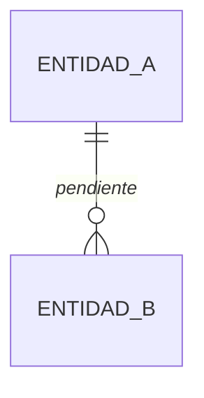

# Datos

**Cuándo se consulta:** antes de cualquier migración, de crear o cambiar una tabla, o de escribir
una consulta nueva. **Cuándo se actualiza:** con cada tabla, campo, relación o política que
cambia, en la misma sesión que el código.

## Qué guardamos

<!-- Un bloque por entidad: para qué existe y sus campos con tipo y restricción. Ejemplo:

     ### perfiles
     Datos de la persona que no gestiona el proveedor de autenticación.
     | Campo | Tipo | Regla |
     | id | uuid, clave ajena a auth.users | |
     | nombre | texto | obligatorio |
     | creado_el | timestamptz | por defecto ahora() | -->

_(pendiente)_

## Cómo se relacionan

## Quién puede ver y tocar qué

<!-- Por tabla: leer, crear, cambiar, borrar, y bajo qué condición. Si es Supabase, son las
     políticas RLS; en otro stack, el equivalente. La regla por defecto es "nadie", y se abre. -->

_(pendiente)_

## Migraciones

<!-- En orden. Quién las aplica y dónde está escrito en architecture.md → Cómo se publica. Cada
     archivo se aplica una vez. -->

| Nº | Archivo | Qué hace | Aplicada en producción |
|----|---------|----------|------------------------|
| _(pendiente)_ | | | |

## Datos de arranque

_(pendiente: si la app necesita datos para funcionar (categorías, roles, un usuario de prueba),
cuáles son y qué script los crea)_

## Datos de prueba

_(pendiente: cómo se crean y se borran los datos que usan los tests; prefijo que los identifica)_

<!-- huella: 32d125f32a3a · plantilla sin tocar; scripts/podar-docs.mjs la usa -->
