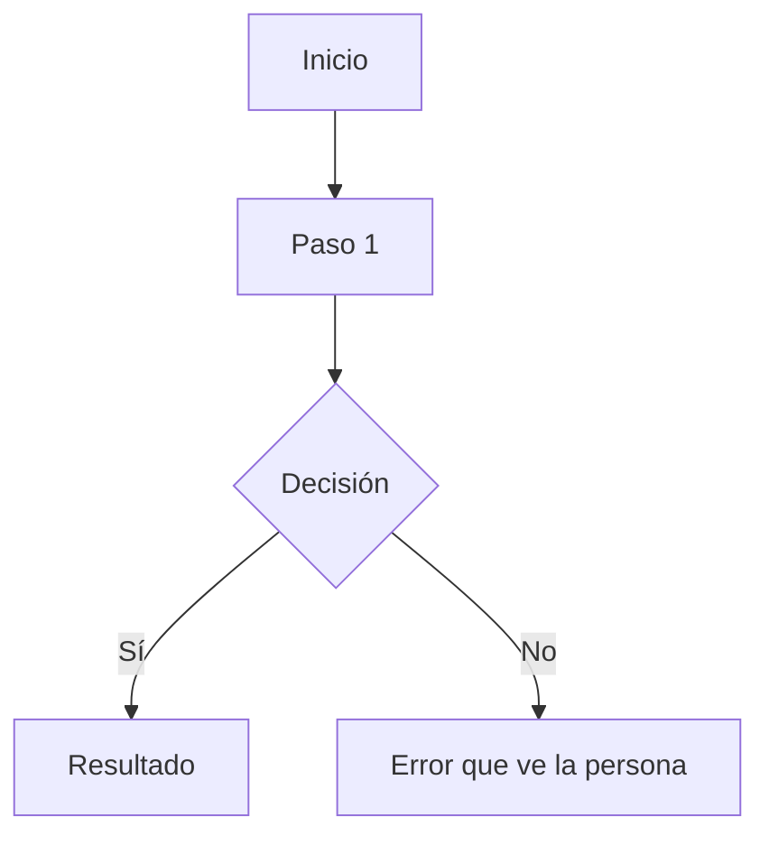

# Flujos

**Cuándo se consulta:** al crear la ficha de una feature con pantallas, y al escribir un test de
navegador (el flujo es el guion del test). **Cuándo se actualiza:** cuando cambia un flujo o
aparece uno nuevo. El PRD los nombra; aquí se detallan.

<!-- Un bloque por flujo, con ID (FLOW-01) para citarlo desde el PRD y desde los tests. -->

## FLOW-01 — _(pendiente: nombre)_

**Quién:** _(pendiente)_
**Empieza cuando:** _(pendiente)_
**Termina cuando:** _(pendiente: qué ha conseguido)_

### Paso a paso

<!-- Cada paso: qué hace la persona y qué ve. Es lo que el test de navegador reproduce. -->

1. _(pendiente)_

### Diagrama

### Si algo sale mal

_(pendiente: en cada paso, qué puede fallar y qué ve la persona exactamente)_

<!-- huella: 1caf4ed4ae09 · plantilla sin tocar; scripts/podar-docs.mjs la usa -->
